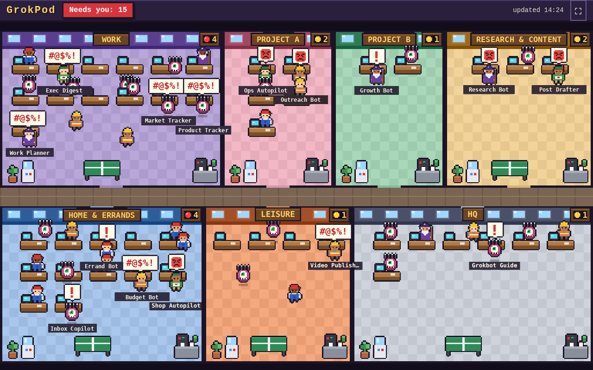
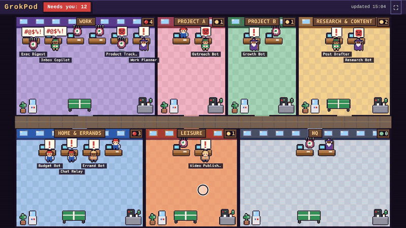

# GrokPod

A pixel-art office where my AI agents sit at their desks, and the ones that need me raise a speech bubble.


<!-- screenshot: docs/screenshot.png (real board, names and rooms renamed). docs/demo.png is the demo data below. -->

## The problem

I run 30+ AI agents (Grok Bot). After a while the app turned into a wall of unread dots:

- **Too many alerts at once.** Every agent pings at the same volume, so nothing tells me where to look first.
- **No sense of progress.** I couldn't tell if an agent was moving its task forward or had silently dropped it.
- **Hidden blockers.** A signed-out session or a broken connector just meant an agent went quiet.

## The taxonomy that fixed my thinking

Before building anything I sorted the agents by **who is allowed to interrupt me**:

| Kind | What it does | Should it interrupt? |
|---|---|---|
| **Report generator** | Digests, trackers, monitors | Never. Only when its sources or integration break. |
| **Autopilot** | Does the work on its own | Never. It should show its work somewhere I can check when I want. |
| **Copilot** | Works with me, needs my decisions | Yes. These are the ones that should pull me in. |

Most of my daily noise came from report generators, the kind that should never interrupt.
In the office, each agent's sprite shows its autonomy level: Observer (report bots, monitors), Operator (autopilots),
and Collaborator / Consultant / Approver (copilots that work with me or wait for my OK).

## How it works

```
agent host data ──► publish_status.py ──► site/status.json ──► here.now site (tablet)
 (message index,      (who is waiting on         │                  │ tap agent → quick reply
  transcripts,         me, and why)              │                  ▼
  session log)                                   │          POST /api/reply (site proxy adds the key)
                                                 │                  ▼
                       router_log.jsonl ◄──── Router agent ◄── webhook routine
                       (answered / snoozed)    relays the answer to the right agent
```

- **Rooms** are areas of life/work. Each agent has a desk in its room (`roster.json`).
- **Needs you: N** in the top bar counts agents waiting on me. Tap it for the list, oldest first.
- **Speech bubbles** grow angrier with age: `!` under 24 h, a red face under 7 days, `#@$%!` after that.
- **Per-room board** (top right of each room): green, yellow or red by how many agents there need me.
- **Three signals** make an agent "need you":
  - `awaiting_reply`: it asked me something in chat and I never answered.
  - `open_card`: an approval/question card or a draft is still open.
  - `broken_connection`: a browser session signed out or a connector needs sign-in.
- **Tap an agent** to see its actual question, with 2-4 quick-reply buttons (`quick_replies.json`), a snooze,
  or a typed answer. Answers are sent silently through a webhook to a **router agent** that relays them to the
  right agent word for word (see [docs/router-prompt.md](docs/router-prompt.md)). An envelope shows over the
  agent for 10 s after a reply; it leaves the board on the next refresh.
- Built for a tablet on the desk: one HTML file, one JS file, procedural sprites, no external assets, refreshes every 3 minutes.

## Try it with demo data

No accounts or keys needed:

```bash
./demo.sh             # serves examples/status.example.json at http://127.0.0.1:8766
./demo.sh pipeline    # builds status.json from a fake message index, then serves it
```



Full-size video: [docs/grokpod-demo.mp4](docs/grokpod-demo.mp4)

## Run it on your own agents

The data scripts read the files a Grok Bot box keeps for its agents (agent profiles, a SQLite message index,
a browser sign-out log). If your agents live somewhere else, adapt `publish_status.py`; the page only needs
a `status.json` in the shape of `examples/status.example.json`.

1. `cp .env.example .env` and fill it in.
2. Copy the examples and make them yours:
   `cp examples/roster.example.json roster.json` (and `quick_replies`, `conn_overrides` if you want them).
   Rooms are the keys of `ROOMS` in `site/grokpod.js`; rename them freely.
3. Optional, for open cards: dump agent transcripts into `transcripts/`, then `python3 parse.py && python3 score.py`.
4. `python3 publish_status.py` writes `site/status.json`. `python3 build.py` prints a one-off audit.
5. Hosting on [here.now](https://here.now): `./refresh.sh` rebuilds status.json, deploys, and keeps the site
   owner-only. Run it from cron or an agent routine.
6. Quick replies: set up the router agent ([docs/router-prompt.md](docs/router-prompt.md)), put its webhook URL in
   `GROKPOD_WEBHOOK_URL` and its key as a here.now secret `GROKPOD_WEBHOOK_KEY`.

Headless checks (needs Chrome + `npm install` in `tools/`): `node tools/clicks.js`, `node tools/toast.js`
(intercepts `/api/reply`, nothing is sent), `node tools/shot.js`.

## Files

| File | What |
|---|---|
| `site/index.html`, `site/grokpod.js` | The dashboard |
| `publish_status.py` | Builds the sanitized `site/status.json` (strips emails, phone numbers, amounts) |
| `parse.py`, `score.py` | Turn transcript dumps into open questions/cards per agent |
| `build.py` | First prototype: a one-off "who needs me and why" audit |
| `herenow.py`, `refresh.sh` | Deploy to here.now and keep it private |
| `config.py`, `.env.example` | All paths and keys come from env vars |
| `examples/` | Fake roster, replies, router log and status to run the demo |

## License

MIT
